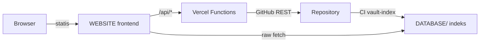

# NAZE-ASSET-VAULT

Vault produksi video NAZE: aset visual, audio, font, 3D, proyek, dan engine
(Motion Engine + NAZE-3D). Repository ini adalah sumber data utama; tidak ada
database eksternal.

## Struktur Direktori

| Direktori | Isi |
| --- | --- |
| `VISUAL/` | Aset visual (3D, ICONS, LOGO, OVERLAY, PARTICLES, RAW, TEXTURE) |
| `AUDIO/` | Musik dan SFX (`AUDIO/MUSIC`, `AUDIO/SFX`) |
| `FONTS/` | Font (DISPLAY, GENERAL, GOOGLE, MONOSPACE) |
| `EXAMPLE_VIDEO/` | Contoh hasil render |
| `NAZE-3D/` | Engine render 3D + aset 3D di `NAZE-3D/assets-3d/` |
| `MOTION-ENGINE/` | Engine video TypeScript (@napi-rs/canvas) |
| `PROJECTS/` | Proyek produksi (masing-masing dengan `project.json` skema naze-project/2.0 bila ada) |
| `CATALOG/` | Katalog legacy dari `scan_assets.py` (statis, dipertahankan apa adanya) |
| `CONFIG/` | Konfigurasi (api.json, pixabay.json) |
| `DATABASE/` | Indeks aset & proyek hasil CI (`assets-index.json`, `projects-index.json`, `schema.json`) |
| `SCRIPTS/` | Skrip indexing (`build-index.mjs`) |
| `WEBSITE/` | Situs manajemen aset (frontend statis + API serverless Vercel) |
| `.github/workflows/` | CI: `render.yml`, `render-3d.yml`, `vault-index.yml` |

## Website Manajemen Aset

`WEBSITE/` berisi hub manajemen aset dan pemantauan CI:

- Dashboard, Assets, Projects, Upload Center, CI Monitor.
- Semua angka berasal dari data repository aktual (indeks `DATABASE/`, dengan
  fallback tree live GitHub API yang ditandai secara jujur).
- Fitur tulis (unggah, buat/hapus proyek, rename, move, delete) memerlukan
  backend terkonfigurasi; tanpa backend situs tetap dapat dibaca.
- Panduan lengkap: [WEBSITE/README.md](WEBSITE/README.md).

Produksi video TETAP dilakukan melalui Vibe + Motion Engine. Situs ini tidak
menggantikan, mengubah, atau menyentuh engine.

## Alur Kerja Cepat

1. Melihat aset: buka halaman Assets (filter kategori/format, pencarian, pratinjau).
2. Unggah: halaman Upload Center (butuh backend + login admin).
3. Membuat proyek: halaman Projects, tombol "+ Proyek Baru".
4. Render video: tetap melalui Vibe + Motion Engine / workflow `render.yml`.

## Standar

Lihat [NAZE-STANDARDS.md](NAZE-STANDARDS.md) dan `naze.policy.json` untuk standar
produksi (1080x1920@60fps CFR, CC wajib, ilustrasi wajib, tanpa dominasi biru).

## Keamanan

- Tidak ada kredensial di kode frontend; operasi tulis lewat backend serverless.
- Sesi cookie HttpOnly/Secure/SameSite + CSRF double-submit + allowlist admin.
- Validasi path ketat (anti-traversal), whitelist ekstensi, batas ukuran unggah.
